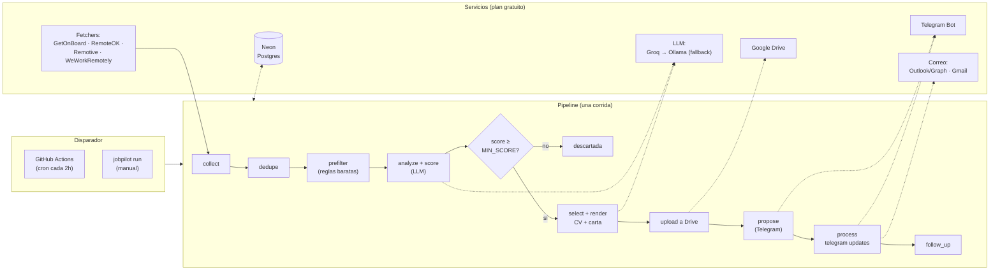
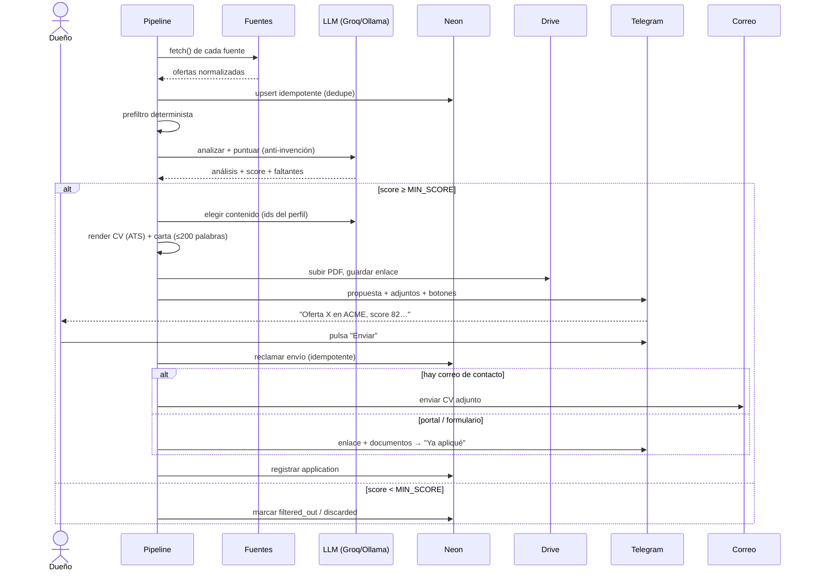
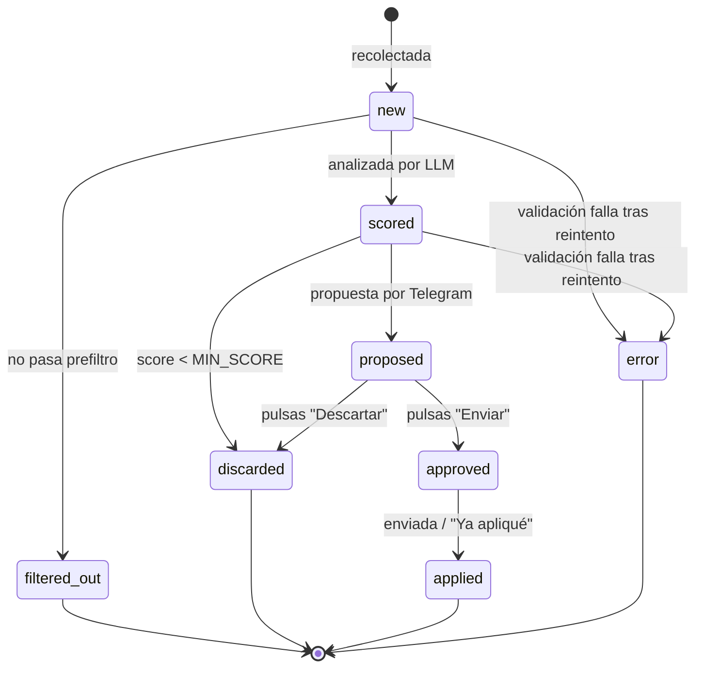
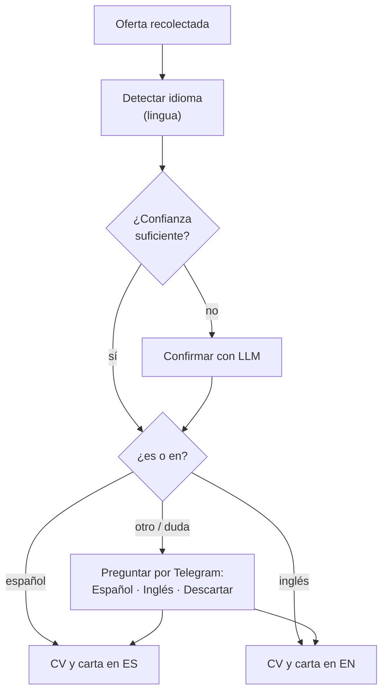
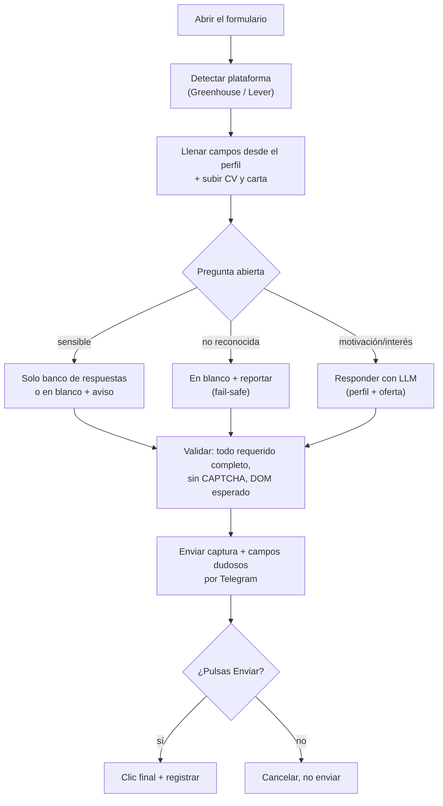

# JobPilot

**Tu copiloto personal de búsqueda de empleo.** JobPilot busca ofertas de trabajo,
las puntúa contra tu perfil, genera un CV en formato ATS y una carta de presentación
adaptados a cada oferta en su idioma, te los propone por Telegram y — **solo tras tu
aprobación explícita** — los envía por correo o te ayuda a llenar el formulario de
aplicación. Todo queda registrado en una base de datos.

> **Principio rector:** nada se envía sin que tú pulses el botón. Eres el humano en
> el circuito; JobPilot hace el trabajo pesado y tú decides.

---

## El problema de negocio

Buscar trabajo es repetitivo y consume tiempo: revisar portales, filtrar ofertas,
reescribir el CV para cada vacante, redactar cartas, aplicar y hacer seguimiento.
JobPilot automatiza todo lo mecánico **sin quitarte el control de ninguna decisión**:

| Dolor manual | Qué hace JobPilot |
|--------------|-------------------|
| Revisar múltiples portales a diario | Recolecta de varias fuentes en cada corrida |
| Leer ofertas que no encajan | Prefiltra con reglas baratas y puntúa con IA contra tu perfil |
| Reescribir el CV para cada oferta | Genera un CV ATS adaptado, solo con hechos reales de tu perfil |
| Redactar cartas genéricas | Escribe una carta corta en el idioma de la oferta |
| Aplicar manualmente | Envía por correo o te deja el formulario listo para el clic final |
| Perder el hilo de dónde apliqué | Registra todo y te recuerda hacer seguimiento |

**Lo que JobPilot nunca hace:** inventar datos sobre ti, enviar sin tu aprobación,
responder preguntas sensibles por su cuenta, ni hacer scraping de LinkedIn/Indeed.

---

## Principios no negociables

1. **Humano en el circuito** — nada se envía sin tu botón de aprobación en Telegram.
2. **Una sola fuente de verdad** — `profile.yaml`. La IA solo elige qué logros y
   proyectos resaltar (por su `id`) y reformula su redacción; **nunca** altera
   hechos, cifras, fechas, cargos ni empresas.
3. **Validación por código** — todo `id` y toda tecnología que menciona la IA se
   verifica contra tu perfil. Si no cuadra, se reintenta una vez; si persiste, la
   oferta se marca `error` en lugar de enviar algo inventado.
4. **Si el perfil no lo tiene, se lista como faltante** — nunca se rellena.
5. **Filtrar barato antes de la IA** — reglas deterministas primero, modelo después.
6. **Preguntas sensibles nunca las responde la IA** — salario, visa, reubicación,
   antecedentes, demografía, años en una tecnología: solo desde tu banco de
   respuestas aprobadas, o se dejan en blanco y te avisan.

---

## Arquitectura en una imagen

JobPilot es un **pipeline por lotes**, no un servidor. Cada corrida (cron de GitHub
Actions o manual) ejecuta el ciclo completo, procesa tus respuestas de Telegram y
termina. El estado vive en Postgres (Neon) y en `profile.yaml`.



Todo se conecta a través de **interfaces (Protocols)**, así cada servicio es
reemplazable y testeable con fakes: `LlmClient`, `JobSource`, `FileStorage`,
`Notifier`, `Mailer`, `JobRepository`, `FormFiller`.

---

## El flujo end-to-end, paso a paso



### Qué pasa en cada etapa

1. **Recolección** — cada fuente (`JobSource`) devuelve ofertas normalizadas. Si una
   fuente falla, se aísla y el pipeline sigue con las demás.
2. **Deduplicación** — por `(source, external_id)` y por `url`. Correr el pipeline
   dos veces no duplica nada (idempotencia garantizada por `INSERT ... ON CONFLICT`).
3. **Prefiltro** — reglas de `config.yaml`: país/remoto, palabras clave obligatorias
   y excluyentes, idioma, modalidad, salario mínimo. Esto ocurre **antes** de gastar
   una sola llamada a la IA.
4. **Análisis y scoring** — el LLM extrae stack, seniority, idioma, modalidad,
   salario, etc., y puntúa de 0 a 100 con pesos configurables. Groq es el principal;
   si falla o se agota la cuota, cae automáticamente a Ollama local.
5. **Umbral** — solo las ofertas con `score ≥ MIN_SCORE` continúan.
6. **Selección y documentos** — el LLM elige la variante de resumen, los logros y
   proyectos a resaltar (solo `id`s de tu perfil), y se renderiza el CV en PDF ATS y
   la carta en el idioma de la oferta.
7. **Subida** — a Google Drive; el enlace queda en la base de datos.
8. **Propuesta** — por Telegram con el CV y la carta adjuntos y botones de decisión.
9. **Envío** — tras tu aprobación: por correo si hay contacto, o modo manual /
   formulario asistido según el portal.
10. **Seguimiento** — recordatorio a los 7 días, comandos de resultado y reporte
    semanal.

---

## Estados de una oferta



Una vez `applied`, el seguimiento cambia el **resultado** (`outcome`) de la
postulación: `pending → interview | rejected | offer | no_response`.

---

## El idioma de cada documento



Solo se usan textos del perfil **ya aprobados** en ese idioma; nada se traduce al
vuelo. El CV sale como `Nombre_Apellido_Empresa_Cargo_ES.pdf` (o `_EN.pdf`), con
encabezados localizados (Resumen/Summary, Experiencia/Experience, etc.).

---

## Telegram: tu panel de control

El bot solo te responde a ti (`TELEGRAM_OWNER_CHAT_ID`).

**Botones de una propuesta:** Enviar · Ajustar · Descartar · Ya apliqué · Español · Inglés

- **Ajustar** acepta una instrucción en lenguaje natural ("hazla más formal") y
  regenera el CV o la carta — respetando siempre tu perfil como fuente de verdad.

**Comandos:** `/pendientes` · `/estado` · `/entrevista <id>` · `/rechazo <id>` · `/buscar`

---

## Modo asistido de formularios (opcional, local)

Para portales como **Greenhouse** y **Lever**, JobPilot llena el formulario por ti
con Playwright, en **tu PC** (nunca en CI), y te deja el último clic:



**Reglas de seguridad (nunca se saltan):** preguntas sensibles solo desde el banco
aprobado; ante cualquier duda, el campo queda en blanco y aparece en la captura que
revisas antes del clic; CAPTCHA o DOM inesperado → detener, capturar pantalla y
avisar; nunca enviar un formulario incompleto; nunca LinkedIn Easy Apply ni Indeed.

---

## Stack técnico

- **Python 3.12**, gestión de dependencias con **uv**.
- **Pydantic v2** (modelos y validación), **ruff** (lint + formato), **mypy**
  (tipado estricto), **pytest** (con mocks de todos los servicios externos).
- **LLM:** Groq (principal, `openai/gpt-oss-120b`) con fallback a **Ollama** local.
- **Base de datos:** Neon (Postgres) con psycopg 3 y reintento de conexión.
- **Archivos:** Google Drive (cuenta de servicio); interfaz lista para Cloudflare R2.
- **Correo:** Outlook/Hotmail vía Microsoft Graph (default) o Gmail API.
- **Documentos:** plantilla HTML → PDF con WeasyPrint.
- **Formularios:** Playwright (solo local).
- **Ejecución:** GitHub Actions (cron cada 2h + manual).

---

## Puesta en marcha

```bash
uv venv --python 3.12
uv pip install -e ".[dev]"
cp .env.example .env                    # completa tus credenciales
cp profile.example.yaml profile.yaml    # o usa `jobpilot import-cv tu_cv.pdf`
```

Dependencias de sistema para WeasyPrint (generación de PDF):

- macOS: `brew install pango cairo gdk-pixbuf libffi`
- Debian/Ubuntu: `apt-get install libpango-1.0-0 libpangocairo-1.0-0 libgdk-pixbuf2.0-0 libffi-dev`

### Comandos

```bash
jobpilot check-all        # verifica cada credencial (Groq, Neon, Telegram, Drive, correo)
jobpilot migrate          # aplica las migraciones de la base de datos
jobpilot import-cv CV.pdf # importa tu CV a un borrador revisable
jobpilot auth-mail        # consentimiento OAuth único para el correo (Outlook/Graph)
jobpilot run              # ejecuta el pipeline completo una vez
jobpilot apply-form <id>  # modo asistido de formulario, LOCAL (requiere `playwright install`)
```

### Verificación con credenciales reales

Las credenciales se configuran al final. Para confirmar que todo conecta:

1. `cp .env.example .env` y completa los valores.
2. `jobpilot check-all` — los 5 checks deben dar OK.
3. `jobpilot migrate` — crea las tablas en Neon.
4. `jobpilot run` — corre el ciclo completo.
5. `jobpilot auth-mail` — guarda el refresh token del correo.
6. (Opcional, local) `jobpilot apply-form <id>` con un formulario Greenhouse/Lever real.

---

## Configuración

- **Secretos** → `.env` (ver `.env.example`). Nunca se commitea.
- **Comportamiento** → `config.yaml` (reglas de prefiltro, pesos de scoring, flags
  de fuentes, periodos de seguimiento).
- **Perfil** → `profile.yaml` (en `.gitignore`), tu única fuente de verdad. Usa
  `profile.example.yaml` como plantilla.

| Servicio | Variables |
|----------|-----------|
| Groq | `GROQ_API_KEY`, `GROQ_MODEL` |
| Neon (Postgres) | `DATABASE_URL` |
| Telegram | `TELEGRAM_BOT_TOKEN`, `TELEGRAM_OWNER_CHAT_ID` |
| Google Drive | `GOOGLE_SERVICE_ACCOUNT_JSON`, `DRIVE_FOLDER_ID` |
| Outlook (Graph, default) | `GRAPH_CLIENT_ID`, `GRAPH_TENANT_ID`, `GRAPH_REFRESH_TOKEN` |
| Gmail (alternativa) | `GMAIL_CLIENT_ID`, `GMAIL_CLIENT_SECRET`, `GMAIL_REFRESH_TOKEN` |

---

## Desarrollo

```bash
uv run ruff check .
uv run ruff format --check .
uv run mypy src
uv run pytest
```

Los tests usan fakes que implementan los Protocols; no se contacta ningún servicio
real. Los tests de PDF que requieren las librerías nativas de WeasyPrint se saltan en
local y corren en CI.

---

---

## Checklist de configuración manual por fase

Las fases se implementan con servicios **fakeados** (ningún servicio real se
contacta en los tests). Esto es lo que tú, como dueño, debes configurar a mano para
que cada capa funcione de verdad con tus credenciales. Hazlo una vez; después todo
corre solo por GitHub Actions.

- **Fase 2 — Recolección**
  - [ ] `DATABASE_URL` de Neon en `.env`.
  - [ ] `jobpilot migrate` para crear las tablas (`jobs`, `applications`, `telegram_state`).
  - [ ] (Opcional) `ADZUNA_APP_ID` / `ADZUNA_APP_KEY` si habilitas Adzuna en `config.yaml`.
- **Fase 3 — Análisis y scoring**
  - [ ] `GROQ_API_KEY` en `.env` (modelo por defecto `openai/gpt-oss-120b`).
  - [ ] (Opcional) Ollama local corriendo si quieres el fallback (`OLLAMA_BASE_URL`, `OLLAMA_MODEL`).
  - [ ] Ajusta `MIN_SCORE` y los pesos de `scoring` en `config.yaml` a tu gusto.
- **Fase 4 — Documentos**
  - [ ] Librerías nativas de WeasyPrint instaladas (ver "Puesta en marcha").
  - [ ] Cuenta de servicio de Google: `GOOGLE_SERVICE_ACCOUNT_JSON` y `DRIVE_FOLDER_ID`.
  - [ ] Carpeta de Drive compartida con el correo de la cuenta de servicio.
- **Fase 5 — Telegram**
  - [ ] Bot creado con @BotFather: `TELEGRAM_BOT_TOKEN`.
  - [ ] `TELEGRAM_OWNER_CHAT_ID` con tu chat id (el bot solo te responde a ti).
- **Fase 6 — Envío**
  - [ ] `MAIL_PROVIDER` (`outlook` por defecto o `gmail`).
  - [ ] Outlook/Graph: `GRAPH_CLIENT_ID`, `GRAPH_TENANT_ID`, luego `jobpilot auth-mail`
        para obtener y guardar `GRAPH_REFRESH_TOKEN`; define `MAIL_FROM_ADDRESS`.
  - [ ] Gmail (alternativa): `GMAIL_CLIENT_ID`, `GMAIL_CLIENT_SECRET`, `GMAIL_REFRESH_TOKEN`.
- **Fase 7 — Seguimiento**
  - [ ] Revisa `follow_up.reminder_after_days` y `follow_up.weekly_report_weekday` en `config.yaml`.
- **Fase 8 — Formularios asistidos (solo local)**
  - [ ] Instala el extra: `uv pip install -e ".[forms]"` y luego `playwright install`.
  - [ ] Nunca corre en CI; se invoca a mano con `jobpilot apply-form <id>`.
- **Fase 9 — Despliegue**
  - [ ] Carga cada secreto en GitHub (Settings → Secrets and variables → Actions).
  - [ ] Variables no secretas (`MIN_SCORE`, `DAILY_APPLICATION_LIMIT`, `DEFAULT_LANGUAGE`) como *variables*.
  - [ ] (Opcional) Ajusta la cadencia del cron en `.github/workflows/pipeline.yml`.
  - Detalle completo en [docs/deployment.md](docs/deployment.md).

---

## Documentación

- [docs/architecture.md](docs/architecture.md) — arquitectura detallada
- [docs/decisions.md](docs/decisions.md) — registro de decisiones (ADRs)
- [docs/deployment.md](docs/deployment.md) — despliegue y secretos

La especificación completa (requisitos, diseño, tareas) vive en
`.kiro/specs/jobpilot/`.
