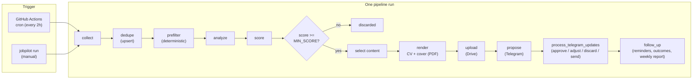
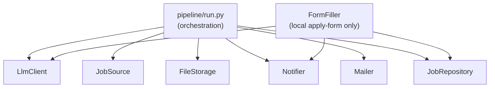

# Architecture

See `.kiro/specs/jobpilot/design.md` for the authoritative design. This file is the
operator-facing summary of how the pieces fit together.

JobPilot is a **batch pipeline, not a long-running service**. Each run (a GitHub
Actions cron tick or a manual invocation) executes the full cycle once, processes
any pending Telegram responses, records everything, and exits. All durable state
lives in Postgres (Neon) and in `profile.yaml`; nothing is held in memory between
runs. This is what makes the free-tier, serverless-cron deployment possible and
what makes every stage idempotent.

## The pipeline, stage by stage

1. **collect** — each enabled `JobSource` returns normalized `RawJob`s. A source
   that fails is isolated and logged; the run continues with the others.
2. **dedupe** — `upsert_job` writes each offer idempotently, keyed on
   `(source, external_id)` and on `url`. Re-running never creates duplicates.
3. **prefilter** — deterministic rules from `config.yaml` (country/remote, required
   and excluded keywords, accepted languages, modality, min salary) run **before**
   any LLM call. Failures become `filtered_out`.
4. **analyze + score** — the LLM extracts structure (stack, seniority, modality,
   salary, language) and scores the offer 0–100 with configurable weights. Every
   prompt embeds the anti-invention rules; every returned id is code-validated.
5. **gate** — only `score >= MIN_SCORE` continues; the rest become `discarded`.
6. **select content** — the LLM picks which profile achievements/projects to
   highlight, by `id` only. Ids and the approved language are code-validated.
7. **render** — Jinja2 templates → WeasyPrint PDF. The CV is single-column ATS
   layout; the cover letter is validated at ≤ 200 words before rendering.
8. **upload** — the PDFs go to Google Drive; the web view link is stored.
9. **propose** — Telegram message with attachments and inline buttons.
10. **process_telegram_updates** — each `update_id` is processed exactly once
    (offset stored in `telegram_state`), driving status transitions and, on an
    explicit Enviar, the send (email or manual) with the application recorded.
11. **follow_up** — due reminders, outcome transitions from `/entrevista` and
    `/rechazo`, and the weekly report on the configured weekday.

## The seven interfaces

Everything external is reached through a Protocol (`src/jobpilot/interfaces.py`), so
every service is swappable and every test uses an in-memory fake instead of the
network:

| Protocol | Concrete implementation(s) | Fake in tests |
|----------|----------------------------|---------------|
| `LlmClient` | `GroqClient` → `OllamaClient` via `FallbackLlmClient` | `ScriptedFakeLlmClient` |
| `JobSource` | GetOnBoard, RemoteOK, Remotive, We Work Remotely (+ optional Himalayas, Adzuna, Gmail alerts) | `FakeJobSource` |
| `FileStorage` | `DriveFileStorage` (R2-ready) | `FakeFileStorage` |
| `Notifier` | `TelegramNotifier` | `FakeNotifier` |
| `Mailer` | `GraphMailer` (default), `GmailMailer` | `FakeMailer` |
| `JobRepository` | `NeonJobRepository` (psycopg 3) | `FakeJobRepository` |
| `FormFiller` | Greenhouse, Lever (Playwright, **local only**) | `FakeFormFiller` |

## Job lifecycle

`new → filtered_out` | `new → scored → discarded` | `scored → proposed →
approved → applied`, with `error` reachable from `new`/`scored` when LLM output
fails validation after one retry. Once `applied`, the application's `outcome`
moves `pending → interview | rejected | offer | no_response` via follow-up.

## Why batch + idempotent

- **Cost**: the whole thing fits in free tiers (GitHub Actions minutes, Neon,
  Groq, Drive) because there is no always-on process.
- **Safety**: a crash mid-run is harmless — the next run re-derives state from the
  database. Dedupe keys, the Telegram offset, and send claims prevent any
  duplicate work from re-processing.
- **Portability**: the same code runs continuously on a VM by wrapping the single
  `get_updates` call in a poll loop; no business logic changes. See
  [deployment.md](deployment.md).
